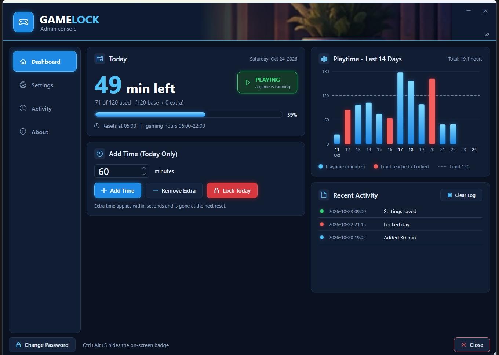
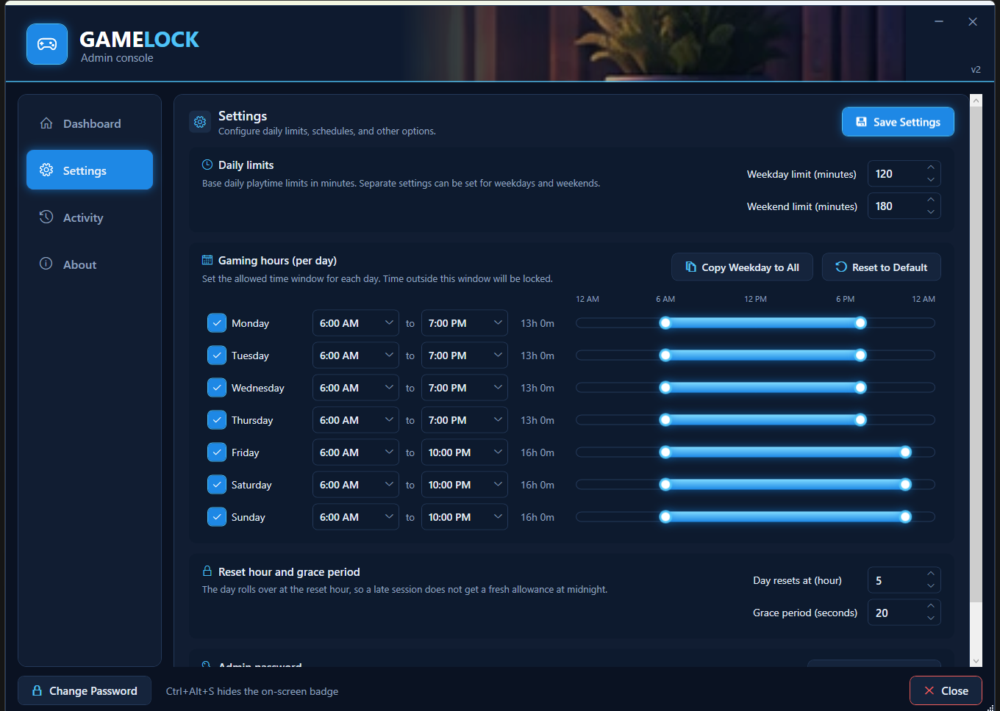
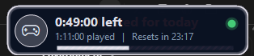

# GameLock

A daily playtime cap for Windows PCs that you cannot talk yourself out of.

GameLock counts time only while a game is actually running, closes the games
when the day's allowance is used up, and puts the controls behind a password
held by someone else. It works with Steam, the Epic Games Launcher,
Battle.net and GOG Galaxy out of the box, and with any other game by exe name.



## What it does

- **Daily allowance**, separate for weekdays and weekends. Time counts only
  while a game process exists; a launcher sitting in the tray costs nothing.
- **Gaming hours per day of the week**, with a visual timeline for each day.
  Untick a day to allow no gaming at all.
- **Save-your-game grace period.** When time runs out, the on-screen badge turns
  red and counts down (default 60 s) before the game is force-closed. One grace
  per reason per day, so relaunching does not earn another.
- **On-screen badge** in the top-right corner: time left, time played, and a
  countdown to the daily reset. Ctrl+Alt+S hides it. Banners warn at 30, 15,
  5 and 1 minutes.
- **Admin panel** (password protected): add extra time for today, lock the day
  outright, change limits, hours, reset time and grace, see the last 14 days
  as a chart, and an activity log of every change.
- **Hard to bypass by accident.** The watcher runs as SYSTEM from a folder only
  administrators can write. Closing the launcher does not free a running game.
  Changing the time zone does not reset the day.



## Install

Requires Windows 10 or 11. No downloads beyond this repository; everything is
PowerShell that ships with Windows.

1. Download the latest release zip and extract it anywhere.
2. Right-click `Install-GameLock.ps1` > **Run with PowerShell**. Approve the
   UAC prompt. When it asks for the admin password, hand the keyboard to the
   person who will be in charge. They type it twice; you should not know it.
3. Right-click `Install-Notifier.ps1` > **Run with PowerShell** (no UAC). This
   installs the badge and the warning banners for your account.
4. A **GameLock** shortcut is now on your desktop. It opens the admin panel
   after a UAC click and the password.

Windows may warn that the scripts were downloaded from the internet. That is
SmartScreen reacting to unsigned PowerShell; the scripts are plain text and you
can read every line.

Optional installer parameters, from a PowerShell window in the folder:

```powershell
.\Install-GameLock.ps1 -LimitMinutes 90 -ResetHour 6 -ExtraProcesses "FortniteClient-Win64-Shipping,RobloxPlayerBeta"
```

`-ExtraProcesses` adds game exe names (without `.exe`) that are not launched
through a supported launcher, so they count and get closed too.

## Day to day

- Play as normal. The badge shows what is left. Banners warn near the end.
- At zero, a red "save now" countdown runs, then the game and the launcher
  close. Reopening the launcher closes it again until the reset hour.
- To allow more time today, the admin opens the **GameLock** shortcut, enters
  the password, sets the minutes and clicks **Add Time**. Extra time applies
  within seconds and disappears at the next reset.
- **Lock Today** shuts gaming down for the rest of the day.
- Everything else lives on the Settings page of the panel.



## How it works

| Piece | Runs as | Lives in |
|------|---------|----------|
| `GameLock.ps1` (watcher) | SYSTEM, scheduled task | `C:\ProgramData\GameLock` |
| `Admin-Panel.ps1` (WPF panel) | the admin, elevated | `C:\ProgramData\GameLock` |
| `Notifier.ps1` + `Show-Overlay.ps1` (badge, banners) | your account, at logon | `%LOCALAPPDATA%\GameLock` |

- The data folder is owned by Administrators; everyone else can only read it.
  The password hash (`secret.json`, salted PBKDF2) is readable by
  administrators and SYSTEM only.
- A "game" is any process launched by a supported launcher (except the
  launcher's own helpers), anything running from a `steamapps\common`,
  `Epic Games` or `GOG Galaxy\Games` folder, anything in `extraProcesses`, and
  anything already seen as a game.
- The day rolls over at the reset hour (default 05:00). Gaming hours and the
  day boundary are judged on UTC plus an offset captured when the reset hour
  was saved, so changing the time zone does not move them.
- The badge and banners are not protected. Removing them only removes the
  warnings; the lock does not depend on them.

Check it is running, from any account:

```powershell
powershell -ExecutionPolicy Bypass -File C:\ProgramData\GameLock\GameLock.ps1 -Once
```

This prints the day, minutes used, whether it is locked, and which processes
currently count as games. It changes nothing.

## Honest limits

- **If the person being limited is a Windows administrator**, they can stop the
  task or edit the files after a UAC click. The lock is deliberate friction,
  not a wall. For a real wall, their account must be a Standard user.
- Games in true exclusive fullscreen may not show the badge or banners. The
  lock still fires. Borderless windowed mode shows both.
- Store-style games (Xbox app, Microsoft Store) launch through a Windows broker
  and are not seen as launcher children. Add them with `-ExtraProcesses`.
- One PC only. Nothing is sent anywhere; there is no account or server.

## Remove

- Watcher and panel: right-click `Uninstall-GameLock.ps1` > Run with PowerShell.
- Badge and banners: right-click `Uninstall-Notifier.ps1` > Run with PowerShell.
- Delete the desktop shortcut.

## Forgot the admin password

Re-run `Install-GameLock.ps1` and answer **n** when it asks whether to keep the
existing password. It then asks for a new one. Settings and history are kept.

## License

MIT. See [LICENSE](LICENSE). GameLock is not affiliated with Valve, Epic,
Blizzard or GOG; launcher names are used only to describe what it detects.
